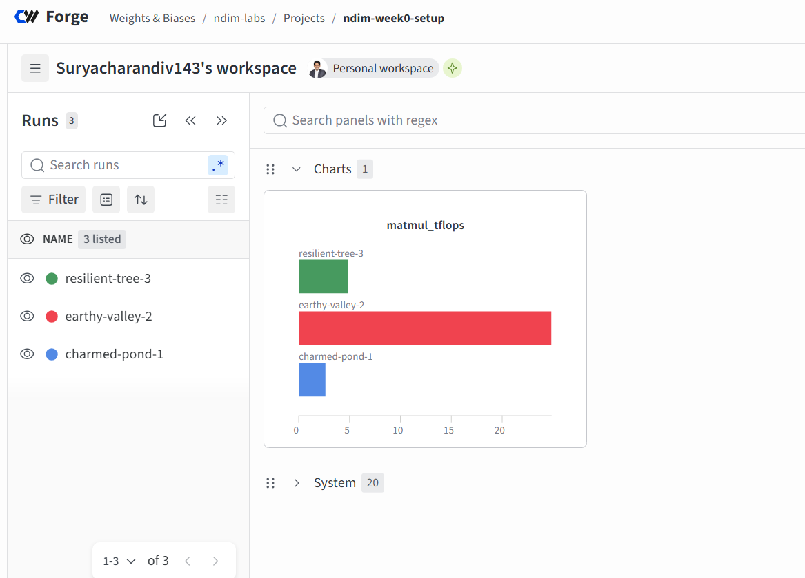
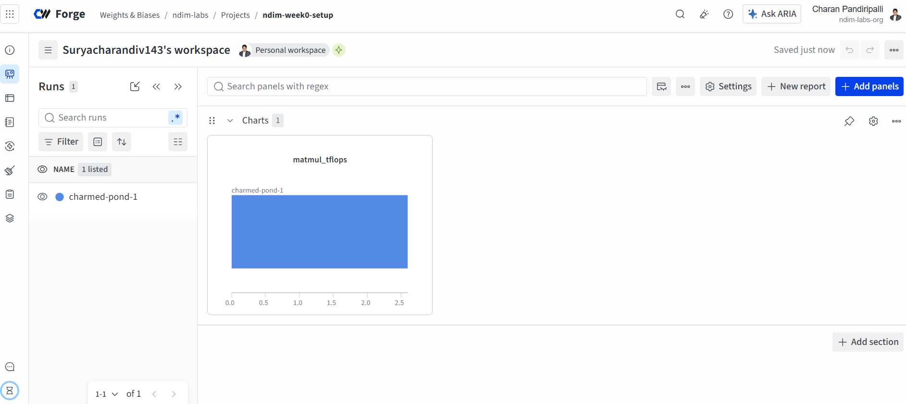

# ndim-infra

Shared environment, compute rules and research log for nDimensions.AI's LLM engineering roadmap.

**Webinar series:** [Decoding Language Models](docs/DECODING-LANGUAGE-MODELS-SERIES.md) — 24 episodes, every alternate day, 12 Oct → 27 Nov 2026.

## Week 0 checklist

Week 0 is setup only. It's done when every box is ticked.

**Org (nDimensions.AI)**
- [x] Create this repo as `ndim-labs/ndim-infra` and push this folder
- [ ] Invite the team to the GitHub org
- [x] W&B: complete the academic application for team `ndim-labs`, then invite the team
- [ ] Create a shared Google Drive folder `nDimensions.AI/ndims-labs/` for checkpoints and datasets

**Everyone**
- [ ] Get Colab Pro on your own account (subscriptions can't be shared)
- [ ] Add `WANDB_API_KEY` to Colab Secrets, then run `colab/bootstrap.ipynb` end to end
- [ ] If you have a local NVIDIA GPU, follow the local setup below and run `scripts/check_env.py`
- [ ] Write your first research-log entry: copy `research-log/TEMPLATE.md` and record your env-check output

## Week 0 results: environment check (2026-10-11)

We ran `scripts/check_env.py` on both machines to prove the pipeline works end to end
(GitHub → Colab or laptop → Google Drive → W&B) and to measure raw GPU speed.
W&B project: `ndim-labs / ndim-week0-setup`.



| W&B run | Machine | GPU | VRAM | Precision | Speed (TFLOPS) | What it shows |
|---|---|---|---|---|---|---|
| `charmed-pond-1` | Colab Pro | Tesla T4 (compute 7.5) | 14.6 GB | bf16 (emulated) | ~2.5 | Bug: the T4 has no bf16 hardware, so PyTorch emulated it slowly |
| `earthy-valley-2` | Colab Pro | Tesla T4 (compute 7.5) | 14.6 GB | **fp16** | **24.9** | After the fix: the T4's real speed, about 10× faster |
| `resilient-tree-3` | Laptop | RTX 3050 6GB Laptop (compute 8.6) | 6.0 GB | bf16 | ~5 | Works, but power-limited. An earlier plugged-in run measured 17.1 |

The first run, before the fix:



**Takeaways**
- On a **T4, train in fp16**, never bf16. On the laptop (Ampere), bf16 is fine.
- The T4 is our workhorse: about 1.5× the laptop's best speed and 2.4× its memory.
- The laptop's speed depends heavily on power. Plug it in and set Windows to *Best performance* before local runs.
- Colab runs torch 2.11 and the laptop runs 2.14. Fine for Phase 1, but check versions if results ever differ.

**Quick definitions**
- **GPU:** a processor built for many parallel math operations, which is what neural-network training is.
- **VRAM:** the GPU's own memory. The model, its gradients and the data batch must all fit in it.
- **TFLOPS:** trillions of floating-point operations per second, a measure of raw GPU speed.
- **Matmul:** matrix multiplication, the core operation inside every neural network; our speed test multiplies two 4096×4096 matrices.
- **fp16 / bf16:** 16-bit number formats that halve memory use and speed up training compared with 32-bit. bf16 has a wider range and is more stable, but needs an Ampere-generation GPU (compute capability 8.0 or higher).
- **Compute capability:** NVIDIA's GPU generation number. 7.5 is Turing (T4); 8.x is Ampere (RTX 30-series, A100).
- **CUDA:** NVIDIA's software layer that lets PyTorch run on the GPU.
- **W&B (Weights & Biases):** a website that records every training run (settings, metrics, charts) so runs can be compared later.
- **Colab Pro:** Google's paid notebook service with cloud GPUs (T4, L4, A100), billed in compute units.

## Compute: where each rung runs

Main GPU: **Colab Pro**. Local GPU (6 GB RTX 3050): **small runs and debugging**.
Get code working locally on a tiny config first, then spend Colab compute units on the real run.

| Rung | Where | Notes |
|---|---|---|
| P1 nanoGPT from scratch | Local | Shakespeare-char trains in minutes on 6 GB |
| P1 LoRA / QLoRA, Qwen 0.5–1.5B | Local | Run the **full fine-tune** baseline on Colab (T4/L4) |
| P2 Unsloth SFT, DPO, 7–8B | Colab L4 / A100 | QLoRA; 7–8B doesn't realistically fit in 6 GB |
| P2 PPO on CartPole | Local | CPU is fine |
| P2 RLHF with TRL | Colab | Keep policy and reward models small (≤1.5B) |
| P2 GRPO, verifiable reward | Colab | Qwen 1.5–3B with Unsloth; 0.5B is fine locally for debugging |
| P3 breadth rungs | Colab | Multi-GPU FSDP/DeepSpeed isn't possible on Colab: do it on a short rented run or skip |
| P4 GRPO against the verifier | **Decide by week 12** | The roadmap assumes 80 GB. Colab's A100 is usually 40 GB. Either size the model to fit or budget a few days on a rented 80 GB GPU |

**Colab Pro budget.** Roughly 100 compute units a month. Approximate burn rates: T4 ≈ 2 CU/h, L4 ≈ 5 CU/h, A100 ≈ 12 CU/h,
so that's about 8 A100-hours or about 50 T4-hours per person per month. Rates change, so check your Colab usage page.
Default to T4/L4 and save the A100 for runs that need it.

## Local GPU setup (Windows)

```bash
uv sync
cp .env.example .env   # then put your W&B key in .env (gitignored, never commit it)
uv run --env-file .env python scripts/check_env.py
```

`uv.lock` pins every package (torch 2.14.1 + CUDA 13.0 wheels). Windows caveats:
- `torch.compile` needs Triton, which isn't available on native Windows. Run nanoGPT with `--compile=False`, or use WSL2.
- Unsloth is most reliable on Linux, so use Colab (or WSL2) for Unsloth rungs.

## W&B

- Team `ndim-labs` on W&B (CoreWeave Forge, academic plan). Everyone logs there: set `WANDB_ENTITY=ndim-labs`.
- One project per rung, e.g. `p1-nanogpt`. Paste the run link into your research-log entry.
- Name runs `<who>-<what>-<n>`, e.g. `upendra-lora-r16-2`.
- Every run gets a matching `research-log/` entry that links the W&B run.

## Rules

- No secrets in git or notebooks. This repo is **public**. Use Colab Secrets or a local `.env` (gitignored).
- No checkpoints or datasets in git. Store them on Drive or as W&B artifacts.
- Before claiming an improvement: held-out test set and three seeds.
